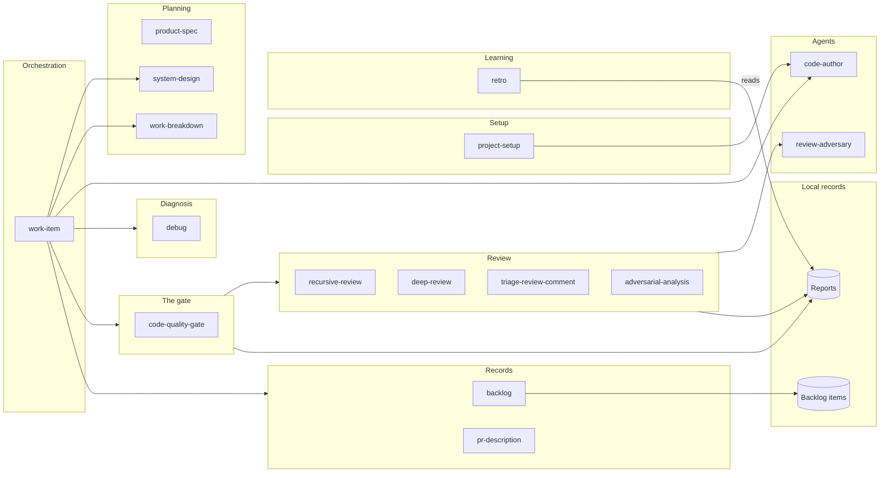
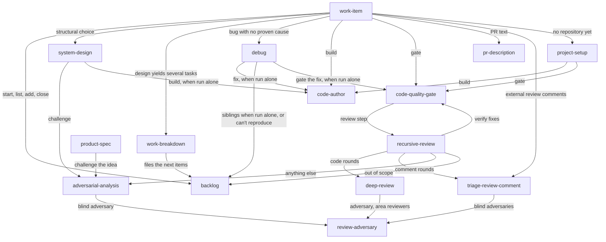
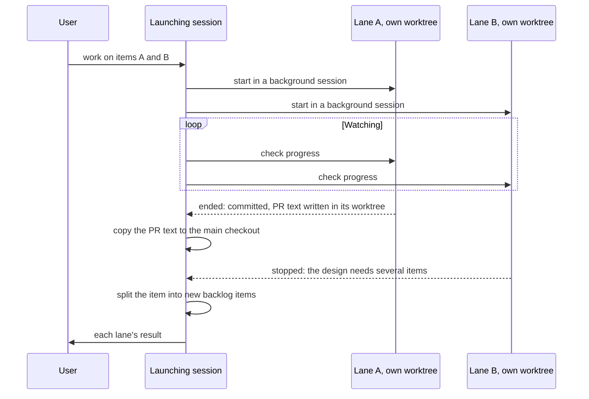

# Architecture

The system is a set of skills and two agents, written first for Claude Code. This page shows how they're grouped, who calls whom, and how several items run at once.

## Terms

- **Skill:** a written procedure the agent loads when a task matches its description. A skill can call other skills and launch agents.
- **Subagent:** an agent the lead launches, with its own context and a fixed set of tools. It gets a task, works, and hands back a report.
- **Lead:** the session running a skill. It launches agents, reads what they hand back, and decides what happens next.
- **Lane:** one backlog item running in its own worktree and background session, alongside others.

## Components

Each skill has one role. The orchestrator owns no work of its own: it calls the others in order.

| Role | Skills | What the role does |
|---|---|---|
| Orchestration | work-item | Carries an item through the other skills, and stops when one can't finish |
| Planning | product-spec, system-design, work-breakdown | Decides whether to build, how to build, and in what pieces |
| Diagnosis | debug | Proves a bug's cause before anyone fixes it |
| The gate | code-quality-gate | Build, warnings, format and lint, tests, then a review loop |
| Review | recursive-review, deep-review, adversarial-analysis, triage-review-comment | Finds what's wrong, with evidence, in rounds |
| Records | backlog, pr-description | Keeps items with stable IDs, and writes the PR text |
| Setup | project-setup | Gives a repository the tooling the gate needs |
| Learning | retro | Finds repeated mistakes, and proposes changes |

## The two agents

- **code-author** writes code. It reuses what exists before it writes anything new, follows the project's conventions, and hands back a list of what changed. It can't run the gate or a review loop, so the lead always checks its work.
- **review-adversary** analyzes. The review skills launch it as a blind adversary, a challenger, an area reviewer or a fresh reviewer.
- **Neither can launch agents or skills.** A review can't recurse through them, and only the lead's own loop repeats.

## Where state lives

- **Backlog items:** Markdown files in the repository's local backlog, each with a permanent ID. Sharing them through version control is the user's call.
- **Reports:** most skill runs write one report, filed by topic, and kept out of version control.
- **Specs, plans and PR text:** written at the repository root, and kept local too.
- **The branch and the commit:** the item and the repository hold all the state a stopped run needs to pick up again.

## Who calls whom

Each arrow is a call. The diagram shows the main calls, not every one. A skill keeps its own rules when another skill calls it.

- **The gate and the review loop call each other.** The gate's last step is a review loop. The loop verifies its own fixes with the gate's first four steps, and never starts another review step inside itself.
- **deep-review and triage-review-comment build on adversarial-analysis.** They change the brief, the checklists and the report. triage-review-comment keeps the blind adversary for every substantive comment, and deep-review keeps it for higher-risk changes.
- **The four review skills and the gate share one block of rules,** kept word for word the same in each.
- **A retro run calls nothing.** It writes a report of proposals. Each change the user approves is then made (code through code-author) and reviewed: a review loop for text, the gate for code.

## Several items at once

Given several items, work-item runs those that don't depend on each other in parallel. Each runs as a lane, in its own worktree and background session. An item that depends on another is stacked on that item's branch.

- **Each lane runs the same steps** as a single item, inside its own worktree.
- **The launching session watches the lanes,** and acts as each one ends.
- **It does the writes a lane can't make from its worktree:** copying the PR text into the main checkout, and splitting an item that turned out too big.
- **Some items never run as lanes.** Security-sensitive items and investigations run in the launching session instead.
