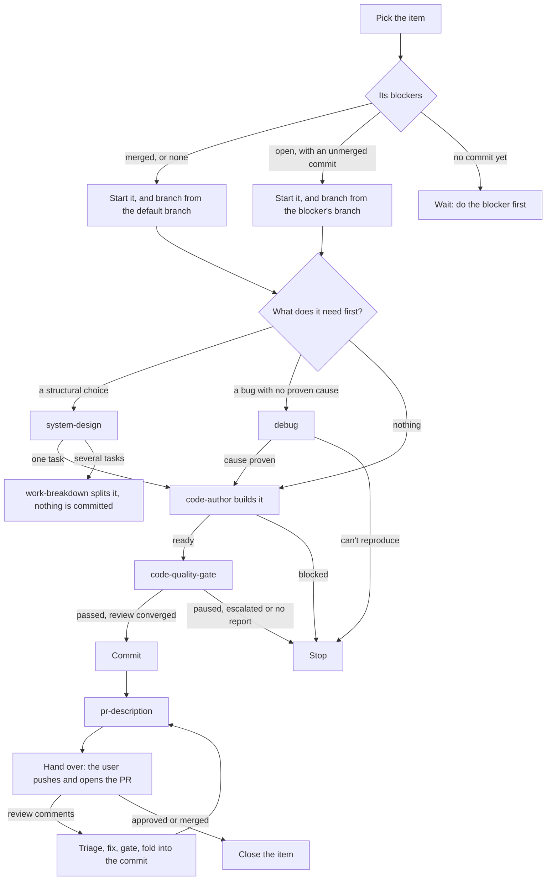

# Work-item flow

work-item carries one backlog item from start to a local commit. It does no work of its own. It calls the skills that do, in order, and stops when one of them can't finish, so half-done work never gets committed.

```
backlog start → branch → code-author → code-quality-gate → commit → PR description → external review → backlog close
```



## 1. Pick the item, and check its blockers

- **The item:** an ID is used as given. "The next task" takes the backlog's suggestion, once the user confirms it. New work is filed first, from a draft the user confirms.
- **No repository yet:** project-setup is offered first. Without one there's no branch and no commit, and an unconfigured project gets a weak gate.
- **Uncommitted files** already in the tree are named, and the user chooses whether to carry on around them. They stay out of the commit either way.
- **An investigation item** answers a question within its time box. When no code remains, it closes with its written answer, and there's no gate and no commit.

Each blocker the item names is checked:

| The blocker | What happens |
|---|---|
| Merged into the default branch | Branch from the default branch |
| Open, with a commit that isn't merged | Stack on the blocker's branch, and say so in the PR text |
| No commit yet | Wait, and say which item to do first |
| Closed but not merged, closed without a fix, or several on separate branches | Ask the user |

## 2. Start it, and branch

- The item's existing branch is reused. Otherwise the branch is named from the item's ID and a short slug.
- Starting the item re-checks the code it cites, and prints a requirements brief. An item that looks obsolete goes to the user.
- A stacked item branches from its blocker's branch.

## 3. Design or debug, when needed

- **A structural choice nobody has made yet,** such as a language, a datastore, a service boundary or a public API, goes to system-design first. Its handoff brief goes to code-author.
- **A design that yields several tasks** means the item was too big. work-breakdown splits it into new items, the item closes as obsolete, pointing to the new items, and nothing is committed.
- **A bug whose cause isn't proven** goes to debug first. It hands back the proven mechanism, a reproduction, and any siblings it found. If it can't reproduce the bug or prove a cause, the run stops.
- **Ordinary work skips this step.** code-author already follows the taste profile.

## 4. Build it

code-author gets:
- the requirements brief, word for word;
- any design brief;
- the branch, and any files to leave alone;
- for a bug, the proven mechanism, the reproduction, and a regression test that fails for that reason before the fix;
- for a bug's siblings, the ones the scope rule keeps in this change. The rest are filed as backlog items.

Its questions go to the user, and the answers go back to the same agent. A handback that says it's blocked stops the run.

## 5. Gate it

| Step | Passes when |
|---|---|
| Build | every target that compiles the changed code builds |
| Errors and warnings | no errors, and no warnings in first-party code those targets build |
| Format and lint | the formatter changes nothing, the linters are clean, and the changed lines follow the project's written guidelines |
| Tests | every test the change could affect passes |
| Review | a review loop over the changed code and what it affects converges |

- **Any step that changes code** sends the gate back to the build. It passes only on a full pass that changes nothing.
- **Dependency version changes** are listed before the build and again at the end, and the user is asked about each. The gate doesn't go past one the user hasn't answered.
- **The run goes on only with a passing report** whose review step names a converged review-loop report that exists. Paused, escalated, or no report at all: the run stops.
- **"Passed with follow-ups pending"** lets the run go on, but the item stays open until those land.

## 6. Commit

- **Files are staged by name,** from code-author's list of changes and whatever the gate's fixes touched. Local records (reports, backlog items, PR text, specs, temporary folders) never go in.
- **The subject carries the item's ID,** in the repository's commit style.
- **The body follows the change's size:** problem, approach and shortcomings in plain sentences for one purpose, or sections for several parts.
- **Local detail is stripped,** because the commit is what gets published: no local paths, no record paths, no test results. For a security-sensitive item, the user is asked before any detail goes in.
- **The project's own commit checks are never skipped.** If one fails, its cause is fixed, and a fix that changes code goes back through the gate.

## 7. Write the PR description

- pr-description writes the PR text, fitted to the repository's template if it has one. Without one, it reuses the commit message word for word.
- Its testing lines come only from the gate's report, each marked passed, failed or not run.
- A stacked item's PR text says what it's stacked on.
- The user posts it under their own name, so it says "ran locally", never "I tested".

## 8. Hand over

- The item stays in progress while the change waits for external review.
- Follow-ups the gate filed start now, stacked on this item's branch. The item stays open until they land.
- The run ends by saying nothing is pushed. The user pushes and opens the PR.

## 9. External review, and closing

**With comments:**
- If the commit is already on a remote, the user is asked before it's amended, since they'll have to replace what's there.
- triage-review-comment judges the comments, and code-author makes the changes the user accepts.
- The gate runs on the review changes as their own subject, with new reports.
- The fixes are folded into the one commit, and the PR text is refreshed to show what ran again.
- Items stacked on this one are named, since each needs a rebase and a new gate run. Neither happens unasked.

**Approved or merged:**
- The item closes as fixed, citing its commit.
- If one of its follow-ups isn't fixed yet, the item stays open, and the run says which and why.

## Several items as lanes

- **Given several IDs or a plan,** items that don't depend on each other run in parallel. Each runs as a lane, in its own worktree and background session.
- **An item that depends on another** is stacked on that item's branch.
- **work-breakdown marks** which items can run in parallel when it plans the work.
- **Each lane runs the same steps** as a single item.
- **The launching session watches the lanes.** As each one ends, it does what the lane can't do from its worktree, such as copying the PR text into the main checkout.
- **Security-sensitive items and investigations** never run as lanes. They run in the launching session.

### What stops a lane

A lane stops at the step that can't finish, like any run:
- a design that needs several items, which the launching session then splits;
- a bug that can't be reproduced, or whose cause can't be proven;
- code-author reporting that it's blocked;
- a gate that doesn't pass: it pauses on a question, escalates, or leaves no report;
- a version change the user hasn't answered.

After any other stop, nothing is committed, the item stays open, and the work stays on its branch. Picking it up later continues from where it got to, since the item and the repository hold the state.
